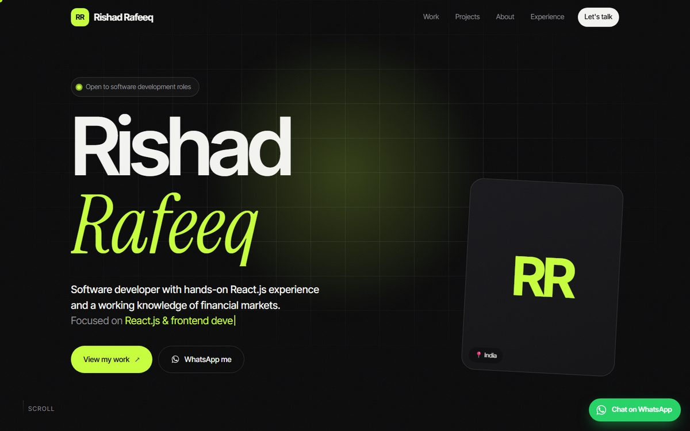
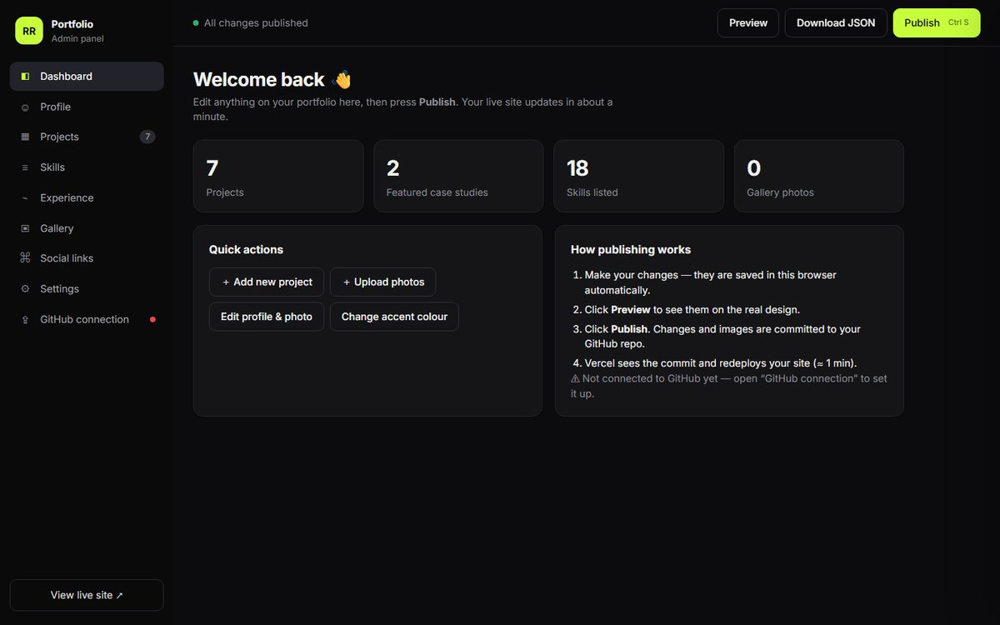
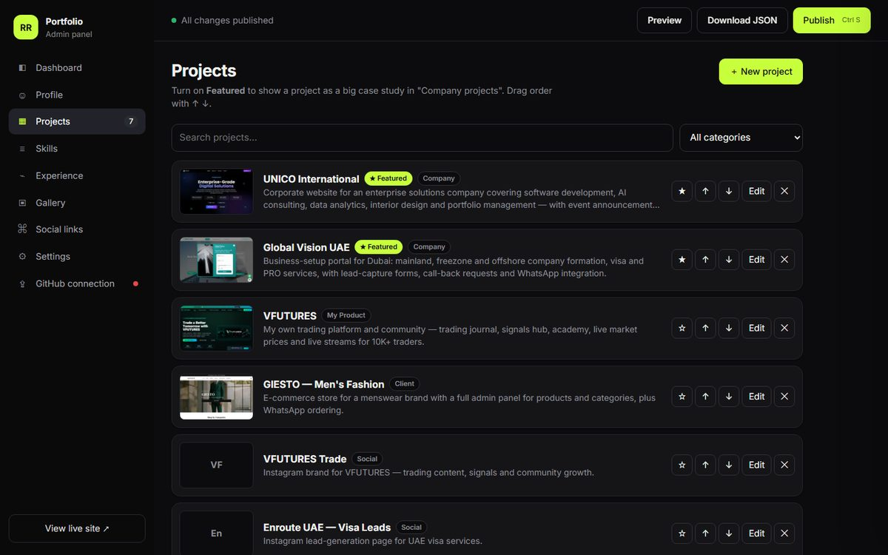

# Rishad Rafeeq — Developer Portfolio

A fast, animated personal portfolio with a **built-in admin panel**, so I can add projects, photos and skills without touching code.
It presents my software development work (React.js / frontend), my financial-markets knowledge, and my leadership & operations work at VFUTURES and Enroute UAE.
Changes made in the admin panel are committed straight to this GitHub repo, and Vercel redeploys the site automatically.



## ✨ Features

**Portfolio site**
- Premium dark design with a single accent colour (changeable from the admin panel)
- Featured **company case studies** in browser-style frames, plus a filterable project grid
- Skills grouped into cards (technical, financial-market knowledge, leadership & operations), each with an optional honesty note
- Direct WhatsApp contact: hero button, contact button and a floating chat button (`wa.me` link)
- Smooth animations: intro loader, line-by-line text reveals, scroll reveals, word-by-word "about" highlight, typing focus areas, animated counters
- Interactive touches: custom cursor, magnetic buttons, spotlight hover on cards, image lightbox
- Fully responsive (desktop, tablet, mobile) and respects `prefers-reduced-motion`
- SEO title/description, Open Graph tags, `robots.txt`

**Admin panel (`/admin`)**
- Dashboard with counts and quick actions
- **Projects:** add, edit, delete, reorder, mark as *featured*, search and filter, upload a screenshot
- **Profile:** name, headline, typing roles, about text, photos, location, email, WhatsApp, résumé link, stats
- **Skill groups, experience (multi-line bullets), social links:** add/edit/reorder/delete
- **Gallery:** multi-photo upload (auto-resized in the browser) with captions
- **Settings:** accent colour, show/hide sections, floating WhatsApp button, SEO
- Changes auto-save in the browser as a draft, with **Preview** on the real design before publishing
- **Publish** saves everything to GitHub as a single commit (content + images), then Vercel deploys
- Backup: download/import `content.json`

| Admin dashboard | Project manager |
|---|---|
|  |  |

## 🛠 Tech stack

- HTML5, CSS3 (custom properties, grid, `color-mix`, clip-path animations), vanilla JavaScript (ES2020+)
- No framework and no build step, so the site loads instantly
- GitHub REST API (Git Data API) for publishing from the admin panel
- Hosted on **Vercel** (static)

## 📁 Project structure

```
.
├── index.html          # Portfolio page (layout only — content is rendered from content.json)
├── content.json        # ALL site content: profile, projects, skills, experience, gallery, settings
├── css/style.css       # Portfolio styles & animations
├── js/main.js          # Renders content.json + interactions
├── admin/
│   ├── index.html      # Admin panel
│   ├── admin.css
│   └── admin.js        # Editing, image upload, drafts, GitHub publishing
├── images/
│   ├── projects/       # Project screenshots
│   └── uploads/        # Images uploaded from the admin panel
├── docs/screenshots/   # README images
├── vercel.json         # Cache + noindex headers
└── robots.txt
```

## 🚀 Run locally

The site loads `content.json` with `fetch`, so open it through a local web server (double-clicking `index.html` won't work):

```bash
python -m http.server 5500
```

Then open <http://localhost:5500> (site) and <http://localhost:5500/admin/> (admin).

## 🌐 Deploy on Vercel

1. Push this repo to GitHub.
2. In Vercel: **Add New → Project → Import** this repository.
3. Framework preset: **Other**. Leave the build command empty and the output directory as the root.
4. Deploy. Every new commit (including admin-panel publishes) triggers a redeploy.

## 🔐 Connecting the admin panel to GitHub (one time)

1. Create a **fine-grained personal access token**: GitHub → Settings → Developer settings → *Fine-grained tokens* → *Generate new token*.
   - Repository access: **Only select repositories** → this repo
   - Permissions → **Contents: Read and write**
2. Open `https://<your-site>/admin/` → **GitHub connection**, enter your username, repo name, branch (`main`) and the token → **Save & test**.

The token is stored **only in your browser** (localStorage) and is sent only to `api.github.com`. It is never committed to the repo.
Without a token, the admin page can still preview and export, but it **cannot change the live site**.

> After publishing from the admin panel, run `git pull` before editing files locally so your copy stays in sync.

## 📄 License

© Rishad Rafeeq. All rights reserved. You're welcome to look through the code for learning purposes.
